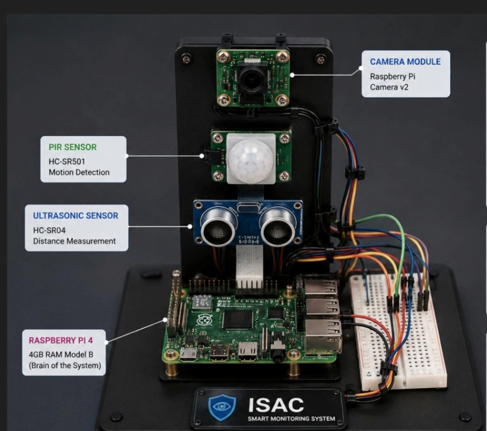
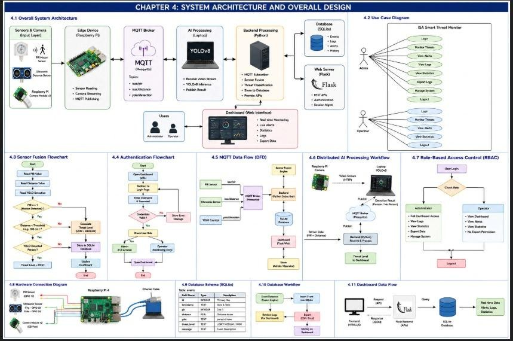

# ISAC Smart Threat Monitor

نظام مراقبة ذكي (AIoT) لمقرر Internet of Things (CCS329) بجامعة الريادة.
الـ Raspberry Pi يجمع حركة PIR ومسافة الالتراسونيك وصورة الكاميرا، واللابتوب يشغّل YOLOv8 ولوحة المراقبة.

## الجهاز



| المكوّن | التوصيل | الوظيفة |
| --- | --- | --- |
| Raspberry Pi 4 Model B (4GB) | Ethernet إلى الشبكة المحلية | عقدة الحساسات |
| HC-SR501 PIR | Signal → GPIO 17 (pin 11)، VCC → 5V (pin 2)، GND → pin 6 | كشف الحركة |
| HC-SR04 Ultrasonic | TRIG → GPIO 23 (pin 16)، ECHO → GPIO 24 (pin 18) | قياس المسافة |
| Raspberry Pi Camera Module v2 | منفذ CSI | صورة 640×480 لـ YOLOv8 |
| Breadboard + jumper wires | — | توصيل GPIO |

خرج ECHO في HC-SR04 جهده 5V، ودخل الـ GPIO يتحمل 3.3V. التقرير يستخدم مقسم جهد: مقاومة 1 kΩ على التوالي مع ECHO، ومقاومة 2 kΩ من GPIO 24 إلى الأرض. TRIG يشتغل مباشرة من 3.3V.

مخطط التوصيل وباقي المعمارية موجودين في الصورة دي:



صور تانية من التقرير:

- [Use case](docs/figures/01-use-case-diagram.jpeg)
- [Sequence diagram](docs/figures/02-sequence-diagram.jpeg)
- [DFD](docs/figures/03-dfd-level1.jpeg)
- [Login](docs/figures/05-dashboard-login.jpeg)
- [HIGH threat](docs/figures/06-dashboard-high-threat.jpeg)
- [UNKNOWN أثناء الإقلاع](docs/figures/07-dashboard-unknown.jpeg)
- [Statistics](docs/figures/08-dashboard-statistics.jpeg)

## هيكل المشروع

```
IOT/                 لوحة Flask + دمج الحساسات + YOLOv8 (على اللابتوب)
raspberry_pi/        كود الـ Raspberry Pi (PIR + ultrasonic + camera)
docs/figures/        صور الجهاز والمخططات من التقرير
```

## التشغيل

على اللابتوب، البروكر على المنفذ 1883. عنوانه الافتراضي في كود اللابتوب هو `Nourseen.local`، وعلى الـ Pi هو `192.168.1.100` زي التقرير. غيّريه بمتغير `MQTT_BROKER` لو الشبكة مختلفة.

```powershell
cd IOT
pip install -r ..\requirements.txt
python detect.py
python backend.py
python app.py
```

اللاب يفتح على `http://localhost:5000`.

على الـ Raspberry Pi:

```bash
sudo apt update
sudo apt install -y python3-rpi.gpio python3-picamera2
pip3 install -r requirements.txt
export MQTT_BROKER=192.168.1.100
chmod +x run_all.sh
./run_all.sh
```

`sensor_node.py` ينشر:

| Topic | المحتوى |
| --- | --- |
| `isac/pir` | `0` أو `1` |
| `isac/distance` | المسافة بالسنتيمتر |
| `camera/frame` و `isa/camera/frame` | إطار JPEG مشفّر base64 |
| `yolo/detection` | `person` أو `none` (من `detect.py` على اللابتوب) |

## Firebase

التسجيل السحابي اختياري. حطي ملف مفتاح الخدمة داخل `IOT/` أو حددي مساره:

```powershell
$env:FIREBASE_CREDENTIALS = "C:\path\to\firebase-adminsdk.json"
$env:FIREBASE_DATABASE_URL = "https://isac-7e65e-default-rtdb.firebaseio.com/"
```

ملف المفتاح مش موجود في الريبو.
